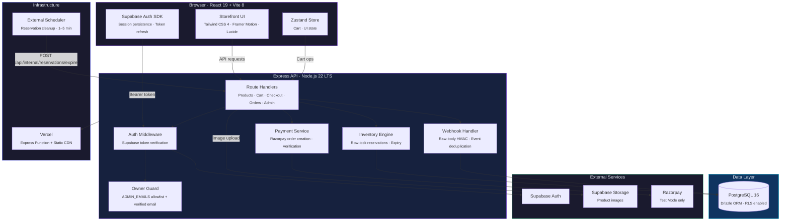
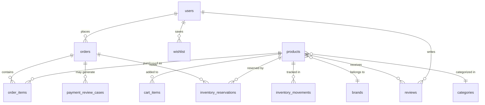

<div align="center">

<!-- ═══════════════════════════════════════════════════════════ -->
<!--                     HERO  SECTION                          -->
<!-- ═══════════════════════════════════════════════════════════ -->

<br/>


<br/><br/>

# ⚡ FLY RC HOBBIES

### Premium RC Models · Genuine Spares · Expert Support

**A production-grade full-stack e-commerce platform engineered for the serious RC enthusiast.**

Built with React 19, Express, PostgreSQL, Drizzle ORM, Supabase Auth, and Razorpay Test Mode payments — deployed on Vercel.

<br/>

[](https://nodejs.org/)
[](https://react.dev/)
[](https://www.typescriptlang.org/)
[](https://vite.dev/)
[](https://expressjs.com/)
[](https://www.postgresql.org/)
[](https://orm.drizzle.team/)
[](https://supabase.com/)
[](https://tailwindcss.com/)
[](https://razorpay.com/)
[](https://vercel.com/)

<br/>

[Overview](#-overview) · [Architecture](#-architecture) · [Features](#-feature-engineering) · [Quick Start](#-quick-start) · [Security](#-security-model) · [Database](#-database) · [Testing](#-testing) · [Deployment](#-deployment) · [API Reference](#-api-reference)

---

</div>

<br/>

## 📋 Overview

Fly RC Hobbies is a full-stack storefront for radio-controlled cars, boats, crawlers, and spare parts. It is not a template — it is a real application with customer authentication, database-backed carts, transactional checkout, inventory reservations, payment verification, an owner management dashboard, and guarded database initialization workflows.

**What is implemented today:**

- Public catalog with brand, category, and collection browsing
- Customer accounts via Supabase Auth (registration, login, email confirmation, password recovery)
- Guest and signed-in shopping carts with safe merge-on-login
- Checkout with server-recalculated pricing and 20-minute inventory reservations
- Razorpay **Test Mode** payment flow with HMAC-verified webhooks
- Owner dashboard for products, inventory, orders, payment reviews, and contact inquiries
- Vercel staging deployment with Express Function model
- Guarded, fingerprinted database initialization and migration tooling

**What is not yet live:**

- Live Razorpay payment processing (only Test Mode keys are configured)
- Production deployment (staging is operational; production has not been independently verified)
- Automated email notifications for orders or contact inquiries

<br/>

## 🏗 Architecture

The system separates concerns into a React SPA for the browser, an Express API for business logic, PostgreSQL for state, and external services for authentication, storage, and payments.



### Technology Stack

| Layer | Technology | Role |
|:---|:---|:---|
| Frontend | React 19, Vite 8, React Router 7 | Single-page application with HMR |
| Styling | Tailwind CSS 4, Framer Motion, Lucide React | Responsive UI, animations, icons |
| State | Zustand 5 | Client-side cart and UI state |
| Backend | Express 4, TypeScript 7 | REST API, middleware, webhooks |
| Runtime | Node.js 22 LTS, Bun | Server runtime, package management |
| Database | PostgreSQL 16, Drizzle ORM | Schema, migrations, transactions, row locks |
| Auth | Supabase Auth | Customer accounts, session management |
| Storage | Supabase Storage | Product images (JPEG, PNG, WebP, AVIF ≤ 4 MiB) |
| Payments | Razorpay Test Mode | Checkout, HMAC verification, webhooks |
| Validation | Zod 4 | Runtime input/output validation |
| Deploy | Vercel (Express Function) | Same-origin SPA + API |

<br/>

## ⚙ Feature Engineering

### Customer Experience

| Feature | How It Works |
|:---|:---|
| **Product catalog** | Browsable by category, brand, and collection. Filtering, search, and product detail pages with RC-specific attributes (scale, terrain, drive type, skill level). |
| **Guest cart** | Stored in `localStorage` under `rc-mega-cart`. No account required to browse or build a cart. |
| **Signed-in cart** | Persisted in PostgreSQL via `/api/cart`. Keyed by the verified Supabase UUID — the API never accepts a customer ID from the request body. |
| **Cart merge** | On sign-in, guest items merge into the database cart. The merge carries a UUID idempotency key: retries replay safely, but reusing a key with a different payload is rejected. |
| **Checkout** | Server recalculates all prices from PostgreSQL. Creates a `PENDING` order and reserves stock for 20 minutes in a single transaction. Client totals are never trusted. |
| **Payment** | Razorpay Test Mode checkout in the browser. Server verifies the callback HMAC, fetches the payment from Razorpay, and requires an exact amount match before marking the order `PAID`. |
| **Order history** | Customers view their orders at `/account`. Order items carry immutable name/slug/price snapshots from the moment of purchase. |
| **Contact form** | Validated submissions stored in PostgreSQL, visible to the owner. No automatic email is sent. |

### Owner Dashboard

| Feature | How It Works |
|:---|:---|
| **Product management** | Create, edit, and manage products at `/admin`. New products start as unpublished drafts. The API never deletes products. |
| **Image uploads** | Uploads go through the owner-protected Express endpoint to Supabase Storage. JPEG, PNG, WebP, AVIF up to 4 MiB. |
| **Inventory control** | Set stock quantities, track movements with audit trail (`inventory_movements` table). Stock edits cannot go below active reservations. |
| **Order management** | View all orders, update fulfillment status through allowed transitions at `/admin/orders`. |
| **Payment review** | Captured payments with expired reservations go to an owner-visible review queue — never auto-fulfilled or auto-refunded. |
| **Inquiry inbox** | Contact submissions visible at `/admin/inquiries`. Rate-limited per Express instance. |

### Backend Engineering

| Capability | Implementation |
|:---|:---|
| **Idempotent checkout** | UUID `Idempotency-Key` header scoped to the customer. Order, items, reservations, and cart removal in one transaction. |
| **Inventory reservations** | Product rows locked in ascending ID order to prevent deadlocks. Reservation totals checked after locks. 20-minute expiry. |
| **Webhook deduplication** | Razorpay event IDs stored in `razorpay_webhook_events`. Raw-body HMAC verified with `crypto.timingSafeEqual`. A paid order cannot be downgraded. |
| **Row-Level Security** | RLS enabled on all application tables (migration `0007`). No browser-side `supabase.from()` table access. |
| **Health endpoints** | `GET /api/health` (liveness, no DB) and `GET /api/ready` (readiness, read-only `SELECT 1` with 3-second timeout). |

<br/>

## 🚀 Quick Start

### Prerequisites

- **Node.js 22 LTS** — `>=22.12.0 <23` (see `engines` in `package.json`)
- **Bun** — the repo uses `bun.lock`
- **PostgreSQL 16** — local instance or Supabase project

### 1. Install

```sh
bun install --frozen-lockfile
```

### 2. Configure

```sh
cp .env.example .env
```

Edit `.env` with your PostgreSQL credentials and Supabase project keys. See the [Environment Variables](#-environment-variables) section for the complete reference.

> **⚠️ Never prefix server secrets with `VITE_`.** Database URLs, service-role keys, Razorpay secrets, and webhook secrets must remain server-only.

### 3. Initialize Database

For a **new empty database**, use the guarded fresh initializer:

```powershell
$env:FRESH_DATABASE_URL = 'postgresql://fresh_user:<PASSWORD>@127.0.0.1:5432/rcmega_fresh'
$env:FRESH_DATABASE_EXPECTED_FINGERPRINT = 'localhost:5432/rcmega_fresh'
$env:FRESH_DATABASE_ENABLED = 'true'
$env:FRESH_DATABASE_CONFIRMATION = 'I_CONFIRM_EMPTY_NONPRODUCTION_DATABASE'
$env:FRESH_DATABASE_SSL = 'false'
bun run db:init:fresh -- --confirm-empty-database
```

Then apply forward migrations and seed data:

```sh
bun run db:migrate
bun run db:seed:reference
bun run db:seed:products   # optional — sample catalog (drafts, zero stock)
bun run db:seed:parts      # optional — spare-parts catalog
```

> **Note:** Seeded products start as zero-stock, unpublished drafts. Set inventory and publication state through the owner dashboard at `/admin`.

### 4. Run

```sh
bun run dev
```

The dev server uses `tsx` with Vite middleware for instant HMR.

### 5. Build & Serve

```sh
bun run build                       # Vite frontend + ESM server bundle
NODE_ENV=production bun run start   # node server.js
```

<br/>

## 🔒 Security Model

```
┌─────────────────────────────────────────────────────────────┐
│                     Trust Boundaries                         │
├─────────────────────────────────────────────────────────────┤
│                                                             │
│  Browser ──── HTTPS ────► Express API ────► PostgreSQL      │
│                              │                              │
│  ┌───────────────────────────┼──────────────────────────┐   │
│  │        Server-Only Zone   │                          │   │
│  │  • DATABASE_URL           │  • RAZORPAY_KEY_SECRET   │   │
│  │  • SERVICE_ROLE_KEY       │  • WEBHOOK_SECRET        │   │
│  │  • ADMIN_EMAILS           │  • CRON_SECRET           │   │
│  └───────────────────────────┴──────────────────────────┘   │
│                                                             │
│  Browser receives ONLY: VITE_SUPABASE_URL,                  │
│  VITE_SUPABASE_ANON_KEY, RAZORPAY_KEY_ID (public)           │
└─────────────────────────────────────────────────────────────┘
```

| Protection | Implementation |
|:---|:---|
| **Auth verification** | Every protected request is verified server-side with `Supabase.auth.getUser()`. No trust in client-supplied identity. |
| **Owner authorization** | Server-side `ADMIN_EMAILS` allowlist plus Supabase `email_confirmed_at`. Frontend roles and `users.is_admin` are not used. |
| **Cart ownership** | Keyed to the Supabase UUID from the verified token — never from the request body. |
| **Price integrity** | Checkout prices and totals recalculated from PostgreSQL. Client-submitted amounts are ignored. |
| **Idempotency** | Checkout and cart-merge operations carry UUID idempotency keys. Retries are safe; different payloads with the same key are rejected. |
| **Payment verification** | Razorpay callback HMAC verified against the stored order ID. Server fetches the payment and requires captured status, exact amount, and INR currency. |
| **Webhook authenticity** | Raw request body verified with `crypto.timingSafeEqual`. Provider event IDs deduplicated. Failed/out-of-order events cannot downgrade a paid order. |
| **Row-Level Security** | RLS enabled on all application tables (migration `0007`). No direct browser-to-table access. |
| **Database guards** | Fresh initialization requires fingerprint matching, collision checks against all configured targets, explicit opt-in flags, and typed confirmation values. |
| **Test isolation** | Integration tests compare their target against every app/migration database. Collisions fail closed. |

> **Important:** These protections are implemented in the application layer. This documentation is not proof that the system is completely secure. Production deployment requires independent security review.

<br/>

## 📂 Project Structure

```
torque-rc-store/
├─ server.ts                          Express entry (dev + Vercel Function)
├─ server.js                          Built standalone bundle (production)
├─ vite.config.ts                     Vite 8 build configuration
├─ vercel.json                        Vercel routing rules
│
├─ src/
│  ├─ App.tsx                         React root — routes and providers
│  ├─ pages/
│  │  ├─ AuthPages.tsx                Login, Register, ForgotPassword
│  │  ├─ AccountDashboardPage.tsx     Customer profile and order history
│  │  ├─ CollectionPage.tsx           Product catalog with filters
│  │  ├─ ProductDetailPage.tsx        Product detail with cart controls
│  │  ├─ CheckoutPage.tsx             Checkout flow with delivery form
│  │  ├─ ContactPage.tsx              Public contact form
│  │  ├─ AdminDashboardPage.tsx       Owner dashboard overview
│  │  ├─ AdminProductsPage.tsx        Product CRUD and image upload
│  │  ├─ AdminOrdersPage.tsx          Order management
│  │  ├─ AdminInventoryPage.tsx       Stock adjustments
│  │  ├─ AdminCatalogPage.tsx         Catalog tools and preview
│  │  └─ AdminContactInquiriesPage.tsx  Inquiry inbox
│  │
│  ├─ components/
│  │  ├─ layout/                      Navbar, Footer, Layout wrapper
│  │  ├─ home/                        Hero, FeaturedProducts, Categories
│  │  ├─ product/                     ProductCard, ProductGrid, Detail
│  │  ├─ cart/                        CartDrawer, CartItem, CartSummary
│  │  ├─ filters/                     FilterSidebar, PriceRange, Facets
│  │  └─ search/                      SearchBar, SearchResults
│  │
│  ├─ store/                          Zustand stores (cart, auth, UI)
│  ├─ auth/                           Supabase client and auth hooks
│  ├─ lib/                            Shared utilities and helpers
│  │
│  ├─ server/
│  │  ├─ auth.ts                      Token verification middleware
│  │  ├─ cart-routes.ts               Cart CRUD + merge endpoint
│  │  ├─ order-routes.ts              Checkout and customer orders
│  │  ├─ payment-routes.ts            Razorpay integration + webhooks
│  │  ├─ inventory.ts                 Reservation engine
│  │  ├─ contact-routes.ts            Contact inquiry endpoint
│  │  ├─ health-routes.ts             /api/health and /api/ready
│  │  ├─ reservation-cron-route.ts    Internal cleanup endpoint
│  │  ├─ admin-product-routes.ts      Owner product management
│  │  ├─ admin-catalog-routes.ts      Catalog tools
│  │  ├─ admin-dashboard-routes.ts    Dashboard data endpoints
│  │  ├─ product-validation.ts        Zod schemas for product input
│  │  └─ razorpay.ts                  Razorpay client initialization
│  │
│  └─ db/
│     ├─ schema.ts                    Drizzle table definitions (15 tables)
│     ├─ drizzle.config.ts            Standard migration config
│     └─ drizzle-fresh.config.ts      Fresh-baseline config
│
├─ drizzle/
│  ├─ fresh/                          Immutable baseline (schema ≤ 0005)
│  ├─ 0000–0008_*.sql                 Forward migration files
│  └─ meta/                           Drizzle snapshots and journal
│
├─ scripts/                           DB initialization, seeding, staging tools
├─ tests/                             18 test files + fixtures
├─ docs/assets/                       README visual assets
└─ .env.example                       Environment variable template
```

<br/>

## ⚙ Environment Variables

### Database

| Variable | Required | Description |
|:---|:---|:---|
| `DATABASE_URL` | One of this or all `SQL_*` | PostgreSQL URL for Express; used by migrations unless overridden |
| `MIGRATION_DATABASE_URL` | Optional | Separate DDL-permission URL for Drizzle Kit migrations |
| `DATABASE_SSL` | Optional | `auto` (default), `true`, or `false` — auto disables SSL for localhost |
| `DATABASE_CA_CERT` | Optional | PEM CA bundle for providers not in Node's trust store |
| `SQL_HOST` / `SQL_PORT` / `SQL_DB_NAME` / `SQL_USER` / `SQL_PASSWORD` | If no URL | Discrete connection fields |

### Authentication

| Variable | Scope | Description |
|:---|:---|:---|
| `VITE_SUPABASE_URL` | Browser | Supabase project URL |
| `VITE_SUPABASE_ANON_KEY` | Browser | Public anon key — **never** a service-role key |
| `SUPABASE_URL` | Server | Project URL for token verification |
| `SUPABASE_ANON_KEY` | Server | Non-privileged key for Auth verification |
| `ADMIN_EMAILS` | Server | Comma-separated owner email allowlist |
| `SUPABASE_SERVICE_ROLE_KEY` | Server | Storage upload credential — **never** in `VITE_*` |
| `SUPABASE_STORAGE_BUCKET` | Server | Public bucket name (e.g. `product-images`) |

### Payments

| Variable | Description |
|:---|:---|
| `RAZORPAY_KEY_ID` | Test Mode key — **must** begin with `rzp_test_` |
| `RAZORPAY_KEY_SECRET` | Server-only API secret |
| `RAZORPAY_WEBHOOK_SECRET` | Server-only webhook secret |

### Runtime

| Variable | Description |
|:---|:---|
| `PORT` | Express port (default `3000`) |
| `NODE_ENV` | `production` serves built `dist/`; otherwise Vite dev middleware |
| `SHIPPING_FLAT_RATE_INR` | Flat shipping in INR; unset or `0.00` = free |
| `CRON_SECRET` | ≥ 32-char random secret for cleanup endpoint |

<details>
<summary><strong>Fresh database initialization variables</strong></summary>

| Variable | Description |
|:---|:---|
| `FRESH_DATABASE_URL` | Dedicated target with explicit credentials |
| `FRESH_DATABASE_EXPECTED_FINGERPRINT` | Exact `host:port/database` identity |
| `FRESH_DATABASE_ENABLED` | Must equal `true` |
| `FRESH_DATABASE_CONFIRMATION` | `I_CONFIRM_EMPTY_NONPRODUCTION_DATABASE` |
| `FRESH_DATABASE_SSL` | `auto`, `true`, or `false` |
| `ALLOW_REMOTE_FRESH_DATABASE` | `true` + matching fingerprint for remote staging |

</details>

<br/>

## 🗄 Database

### Schema (15 Tables)



All tables have RLS enabled. The full schema is defined in [`src/db/schema.ts`](src/db/schema.ts).

### Migration Strategy

```
drizzle/fresh/0000_application-baseline.sql   ← Immutable baseline (≤ 0005)
drizzle/0006_contact-inquiries.sql            ← Forward migrations
drizzle/0007_application-table-rls-api-hardening.sql
drizzle/0008_owner-catalog-inventory.sql
```

> **⚠️ Migrations `0000`–`0005` alter pre-existing tables.** Do not apply them to an empty database. Use `db:init:fresh` for new databases, then `db:migrate` for forward migrations.

**Standard workflow:**

```sh
# 1. Edit src/db/schema.ts
bun run db:generate    # Generate migration SQL
bun run db:check       # Verify consistency
bun run db:migrate     # Apply to configured target
```

<details>
<summary><strong>Fresh database initialization (detailed)</strong></summary>

The initializer validates URL syntax, explicit credentials, fingerprint, and target collisions before opening a connection. It verifies the connected database name and user, confirms zero user relations, then applies the baseline. The baseline timestamp is later than `0005`, so `db:migrate` skips legacy files and applies only forward migrations.

The initializer uses only `FRESH_DATABASE_URL` — there is no fallback to `DATABASE_URL`, `MIGRATION_DATABASE_URL`, or `SQL_*` credentials. Remote targets are rejected by default; opt-in requires `ALLOW_REMOTE_FRESH_DATABASE=true` plus a matching fingerprint.

</details>

<details>
<summary><strong>Existing database migration (detailed)</strong></summary>

For databases with existing data, do not apply a generated initial migration blindly. Compare the live schema to `src/db/schema.ts`, prepare a baseline that matches the existing database, and test against a backup/staging copy. The fresh-database baseline is not a baseline for existing databases.

`DATABASE_URL` takes precedence over discrete `SQL_*` settings. For migrations: `MIGRATION_DATABASE_URL` → `DATABASE_URL` → discrete `SQL_*` (with `SQL_ADMIN_*` overriding user/password).

</details>

<br/>

## 🧪 Testing

### Unit Tests (no database)

```sh
bun test
```

18 test files covering auth middleware, cart operations, checkout, payments, orders, contact inquiries, health routes, fresh-database initialization, and Supabase staging guards. Uses injected token verifiers — no Supabase credentials or database needed.

### PostgreSQL Integration Tests

Critical checkout contention, payment verification, webhook settlement, and reservation expiry scenarios:

```sh
bun run test:postgres
```

| Variable | Required Value |
|:---|:---|
| `RUN_POSTGRES_INTEGRATION_TESTS` | `true` |
| `TEST_DATABASE_URL` | Disposable DB URL (name must contain `test`) |
| `POSTGRES_TEST_DATABASE_CONFIRMATION` | `I_CONFIRM_DISPOSABLE_TEST_DATABASE` |

> **⚠️ The guard compares against every configured app target. Never point at production.**

<details>
<summary><strong>Docker test database setup</strong></summary>

```powershell
docker run --name rcmega-postgres-test `
  --env POSTGRES_USER=rcmega_test `
  --env POSTGRES_PASSWORD=REPLACE_WITH_DISPOSABLE_PASSWORD `
  --env POSTGRES_DB=rcmega_test `
  --publish 127.0.0.1:55432:5432 `
  --detach postgres:16

psql -h 127.0.0.1 -p 55432 -U rcmega_test -d rcmega_test -W `
  -v ON_ERROR_STOP=1 `
  -f tests/fixtures/postgres-integration-bootstrap.sql

# Verify target identity
psql -h 127.0.0.1 -p 55432 -U rcmega_test -d rcmega_test -W `
  -c "SELECT current_database(), inet_server_addr(), inet_server_port(), current_user;"
```

Cleanup: `docker stop rcmega-postgres-test; docker rm --volumes rcmega-postgres-test`

</details>

**Coverage:**
- ✅ Last-unit checkout contention
- ✅ Payment verification racing with webhook settlement
- ✅ Duplicate webhook delivery (event deduplication)
- ✅ Reservation expiry and stock recalculation
- ✅ Transaction rollback on failed stock consumption

<br/>

## 🚢 Deployment

### Standalone Node.js

```sh
bun run build                        # Vite frontend + ESM server → server.js
NODE_ENV=production bun run start    # node server.js
```

Requirements: Node.js `>=22.12.0 <23`, all server env vars, reachable PostgreSQL.

### Vercel

```sh
bun run build:vercel    # Frontend → public/ (no standalone server.js)
```

Vercel invokes `server.ts` as an Express Function. Static assets are served from Vercel's CDN; `express.static()` is disabled. Set the project **Node.js version to `22.x`**.

| Detail | Value |
|:---|:---|
| Runtime pool | 1 connection per warm Function, 5s timeout |
| Standalone pool | 10 connections |
| Remote SSL | Defaults on — set `DATABASE_SSL=true` |
| Recommended pooler | Supabase transaction pooler (port `6543`) |

### Reservation Cleanup

Expired reservations must be cleaned every 1–5 minutes:

| Method | Command | Auth |
|:---|:---|:---|
| CLI | `bun run db:reservations:expire -- --confirm-cleanup` | `RESERVATION_CLEANUP_ENABLED=true` |
| HTTP | `POST /api/internal/reservations/expire` | `Authorization: Bearer <CRON_SECRET>` |

> **⚠️ Do not use Vercel Hobby Cron** — it supports only daily schedules. Reservations expire in 20 minutes. Use an external scheduler (Vercel Pro Cron, GitHub Actions, Upstash QStash).

<details>
<summary><strong>Supabase staging deployment (advanced)</strong></summary>

A suite of guarded commands provides fingerprinted, collision-checked initialization for dedicated Supabase staging projects. The intended workflow:

1. `bun run db:probe:supabase-staging -- --confirm-staging-identity-probe` — read-only identity discovery
2. `bun run db:check:supabase-staging -- --confirm-staging-preflight` — read-only schema check
3. `bun run db:prepare:supabase-staging-default-privileges -- --confirm-staging-default-privilege-hardening` — if needed
4. `bun run db:init:supabase-staging -- --confirm-staging-initialize` — apply baseline
5. `bun run db:migrate:supabase-staging -- --confirm-staging-migrate` — forward migrations

Every command requires `SUPABASE_STAGING_ENABLED=true`, an official root CA cert, target fingerprint, project reference verification, collision checks, and command-specific confirmation strings. See the original technical documentation for the complete 18-variable configuration reference.

The staging TLS CA must be downloaded from the Supabase Dashboard (Database Settings → SSL Configuration) and stored outside the repository.

</details>

<br/>

## 🔌 API Reference

### Public Endpoints

| Method | Path | Description |
|:---|:---|:---|
| `GET` | `/api/health` | Liveness check (no DB) |
| `GET` | `/api/ready` | Readiness check (read-only query) |
| `GET` | `/api/products` | Catalog listing with filters |
| `GET` | `/api/products/:slug` | Product detail |
| `POST` | `/api/contact-inquiries` | Contact form (rate-limited) |

### Customer Endpoints <sub>(Supabase bearer token)</sub>

| Method | Path | Description |
|:---|:---|:---|
| `GET` | `/api/account/me` | Verified identity |
| `GET/POST/PUT/DELETE` | `/api/cart` | Cart management |
| `POST` | `/api/cart/merge` | Guest cart merge (idempotent) |
| `POST` | `/api/checkout` | Create order + reserve stock |
| `POST` | `/api/payments/razorpay` | Create Razorpay order |
| `POST` | `/api/payments/razorpay/verify` | Verify + settle payment |
| `GET` | `/api/orders` | Order history |

### Owner Endpoints <sub>(token + ADMIN_EMAILS)</sub>

| Method | Path | Description |
|:---|:---|:---|
| `GET/POST/PATCH` | `/api/admin/products` | Product management |
| `POST` | `/api/admin/products/:id/image` | Image upload |
| `GET/PATCH` | `/api/admin/orders` | Orders + fulfillment |
| `GET` | `/api/admin/payment-reviews` | Payment review queue |
| `GET` | `/api/admin/inquiries` | Contact inbox |
| `POST` | `/api/admin/orders/reservations/expire` | Manual cleanup |

### Internal <sub>(CRON_SECRET bearer token)</sub>

| Method | Path | Description |
|:---|:---|:---|
| `POST` | `/api/internal/reservations/expire` | Scheduled cleanup |

<br/>

## 📋 Scripts Reference

| Script | Description |
|:---|:---|
| `bun run dev` | Dev server (tsx + Vite HMR) |
| `bun run build` | Frontend + standalone server bundle |
| `bun run build:vercel` | Frontend + Vercel public/ assets |
| `bun run start` | Run built `server.js` |
| `bun run lint` | TypeScript type-check (`tsc --noEmit`) |
| `bun test` | Unit tests (no DB) |
| `bun run test:postgres` | PostgreSQL integration tests |
| `bun run db:generate` | Generate migration from schema |
| `bun run db:check` | Verify migration consistency |
| `bun run db:migrate` | Apply pending migrations |
| `bun run db:init:fresh` | Guarded fresh-DB initialization |
| `bun run db:seed:reference` | Insert brand/category rows |
| `bun run db:seed:products` | Insert sample products |
| `bun run db:seed:parts` | Insert spare-parts catalog |
| `bun run db:images:update` | Dry-run image update (`--apply` to write) |
| `bun run db:images:distribute` | Dry-run image distribution (`--apply` to write) |
| `bun run db:reservations:expire` | CLI reservation cleanup |

<br/>

## 📎 References

| Resource | Link |
|:---|:---|
| Drizzle ORM | [orm.drizzle.team](https://orm.drizzle.team/) |
| Supabase Auth | [supabase.com/docs/guides/auth](https://supabase.com/docs/guides/auth) |
| Supabase Storage | [supabase.com/docs/guides/storage](https://supabase.com/docs/guides/storage) |
| Razorpay Test Mode | [razorpay.com/docs/payments/test-mode](https://razorpay.com/docs/payments/test-mode/) |
| Express on Vercel | [vercel.com/docs/frameworks/backend/express](https://vercel.com/docs/frameworks/backend/express) |
| Supabase Connections | [supabase.com/docs/guides/database/connecting-to-postgres](https://supabase.com/docs/guides/database/connecting-to-postgres) |

<br/>

---

<div align="center">

<br/>

**Engineered for precision. Built for speed.**

*Fly RC Hobbies — Where Performance Meets Passion.*

<sub>React 19 · Express 4 · PostgreSQL 16 · Drizzle ORM · Supabase · Razorpay · Vercel</sub>

<br/>

</div>
