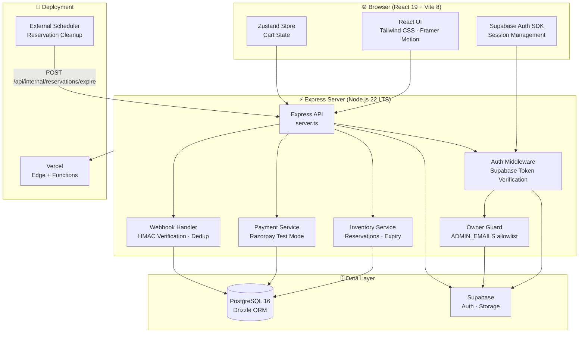
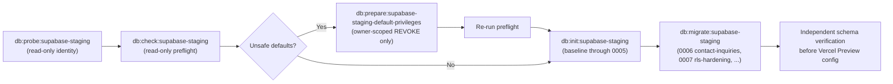

<div align="center">

<br/>

```
██████╗  ██████╗    ███╗   ███╗███████╗ ██████╗  █████╗
██╔══██╗██╔════╝    ████╗ ████║██╔════╝██╔════╝ ██╔══██╗
██████╔╝██║         ██╔████╔██║█████╗  ██║  ███╗███████║
██╔══██╗██║         ██║╚██╔╝██║██╔══╝  ██║   ██║██╔══██║
██║  ██║╚██████╗    ██║ ╚═╝ ██║███████╗╚██████╔╝██║  ██║
╚═╝  ╚═╝ ╚═════╝    ╚═╝     ╚═╝╚══════╝ ╚═════╝ ╚═╝  ╚═╝
```

### 🏁 **Fly RC Hobbies** — Premium RC Models, Genuine Spares & Expert Support

*A production-grade full-stack e-commerce platform built for the serious RC enthusiast*

<br/>

[](https://nodejs.org/)
[](https://react.dev/)
[](https://www.typescriptlang.org/)
[](https://www.postgresql.org/)
[](https://orm.drizzle.team/)
[](https://vite.dev/)
[](https://supabase.com/)
[](https://tailwindcss.com/)
[](https://vercel.com/)
[](https://razorpay.com/)

<br/>

[**🚀 Quick Start**](#-quick-start) · [**🏗️ Architecture**](#️-architecture) · [**⚙️ Environment Variables**](#️-environment-variables) · [**🗄️ Database**](#️-database-setup) · [**🚢 Deployment**](#-deployment)

<br/>

---

</div>

## 🎯 What is RC MEGA?

**RC MEGA** is the storefront powering **Fly RC Hobbies** — a premium e-commerce experience for RC car enthusiasts. It's a production-ready, full-stack web application built with a modern TypeScript stack, offering:

| 🛒 Customer Experience | 🔧 Owner Dashboard | 🔒 Security & Ops |
|---|---|---|
| Browsable product catalog with filters | Complete product & inventory management | Supabase Auth with email verification |
| Guest & signed-in shopping cart | Order lifecycle & fulfillment tracking | Server-side owner allowlist |
| Razorpay Test Mode checkout | Payment review & reconciliation | Row-Level Security on all app tables |
| Real-time stock & reservation display | Customer inquiry inbox | Idempotent checkouts & webhooks |
| Responsive, animated React UI | Image uploads via Supabase Storage | Guarded, fingerprinted DB initialization |

---

## 🏗️ Architecture



### Tech Stack At a Glance

| Layer | Technology | Purpose |
|---|---|---|
| **Frontend** | React 19 + Vite 8 | SPA with HMR development workflow |
| **UI/UX** | Tailwind CSS 4 + Framer Motion + Lucide React | Responsive, animated storefront |
| **State** | Zustand 5 | Lightweight client-side cart & UI state |
| **Routing** | React Router DOM 7 | Client-side SPA routing |
| **Backend** | Express 4 + TypeScript | REST API, middleware, SSE, webhooks |
| **Runtime** | Node.js 22 LTS + Bun | Development tooling + locked dependencies |
| **Database** | PostgreSQL 16 + Drizzle ORM | Schema, migrations, transactions, row locks |
| **Auth** | Supabase Auth | Customer accounts, email verification, sessions |
| **Storage** | Supabase Storage | Product image uploads (JPEG/PNG/WebP/AVIF ≤ 4 MiB) |
| **Payments** | Razorpay Test Mode | Checkout, webhook settlement, HMAC verification |
| **Validation** | Zod 4 | Runtime schema validation throughout |
| **Deployment** | Vercel (Express Function) | Same-origin SPA + API on Edge infrastructure |

---

## 🚀 Quick Start

### Prerequisites

- **Node.js 22 LTS** — version `>=22.12.0 <23` (see `engines` in [`package.json`](./package.json))
- **Bun** — the repo ships a `bun.lock` lockfile
- **PostgreSQL 16** — local instance or a Supabase project

### 1 — Install dependencies

```sh
bun install --frozen-lockfile
```

### 2 — Configure environment

```sh
cp .env.example .env
# Edit .env — set your PostgreSQL credentials and Supabase project keys
```

> **Important:** Never prefix server secrets with `VITE_`. Keep `DATABASE_URL`, `SUPABASE_SERVICE_ROLE_KEY`, `RAZORPAY_KEY_SECRET`, and `RAZORPAY_WEBHOOK_SECRET` server-only.

### 3 — Initialize a fresh local database

Create an empty local PostgreSQL database, then run the guarded fresh-database initializer:

```powershell
# PowerShell — replace placeholders; never commit credentials
$env:FRESH_DATABASE_URL = 'postgresql://fresh_user:<URL-ENCODED-PASSWORD>@127.0.0.1:5432/rcmega_fresh'
$env:FRESH_DATABASE_EXPECTED_FINGERPRINT = 'localhost:5432/rcmega_fresh'
$env:FRESH_DATABASE_ENABLED = 'true'
$env:FRESH_DATABASE_CONFIRMATION = 'I_CONFIRM_EMPTY_NONPRODUCTION_DATABASE'
$env:FRESH_DATABASE_SSL = 'false'
bun run db:init:fresh -- --confirm-empty-database
```

Then apply forward migrations and seed reference data:

```sh
bun run db:migrate
bun run db:seed:reference
bun run db:seed:products   # optional sample catalog
bun run db:seed:parts      # optional spare-parts sample
```

> **Note:** Seeded sample products start as **zero-stock drafts** — they are not immediately sellable. Set inventory and publication state deliberately through the owner dashboard at `/admin`.

### 4 — Start development

```sh
bun run dev
```

The development server runs TypeScript source through `tsx` with Vite middleware for instant HMR.

---

## 📁 Project Structure

```
torque-rc-store/
├── server.ts                     # Express entry point (dev + Vercel Function)
├── server.js                     # Built standalone Node bundle (production)
├── src/
│   ├── App.tsx                   # React root — routes & providers
│   ├── pages/                    # Route-level page components
│   │   ├── Home, Catalog, Product, Cart, Checkout
│   │   ├── Account, Login, Register, ForgotPassword
│   │   └── admin/  (Dashboard, Products, Orders, Inquiries)
│   ├── components/
│   │   ├── layout/               # Navbar, Footer, Layout wrapper
│   │   ├── home/                 # Hero, FeaturedProducts, Categories
│   │   ├── product/              # ProductCard, ProductGrid, Detail
│   │   ├── cart/                 # CartDrawer, CartItem, CartSummary
│   │   ├── filters/              # FilterSidebar, PriceRange, Facets
│   │   └── search/               # SearchBar, SearchResults
│   ├── store/                    # Zustand stores (cart, auth, UI)
│   ├── auth/                     # Supabase client, auth hooks
│   ├── lib/                      # Shared utilities & helpers
│   └── server/                   # Express route handlers
│       ├── auth.ts               # Token verification middleware
│       ├── cart-routes.ts        # Cart CRUD endpoints
│       ├── inventory.ts          # Reservation logic
│       ├── orders.ts             # Checkout, payment, fulfillment
│       └── admin/                # Owner-only management endpoints
├── src/db/
│   ├── schema.ts                 # Drizzle table definitions
│   ├── drizzle.config.ts         # Migration config (standard)
│   └── drizzle-fresh.config.ts   # Fresh-database baseline config
├── drizzle/
│   ├── fresh/                    # Immutable fresh-database baseline (through 0005)
│   └── 0000–000N_*.sql           # Incremental forward migrations
├── tests/
│   ├── fixtures/                 # PostgreSQL integration bootstrap SQL
│   └── *.test.ts                 # Unit + integration test suites
├── scripts/                      # DB admin, seeding, deployment scripts
├── public/                       # Static assets
├── .env.example                  # Environment variable template
└── vercel.json                   # Vercel routing configuration
```

---

## ⚙️ Environment Variables

### 🗄️ Database

| Variable | Required | Description |
|---|---|---|
| `DATABASE_URL` | One of this or all `SQL_*` | PostgreSQL URL for the Express runtime; used by migrations unless overridden |
| `MIGRATION_DATABASE_URL` | Optional | Separate DDL-permission URL for Drizzle Kit migrations only |
| `DATABASE_SSL` | Optional | `auto` (default) · `true` · `false` |
| `DATABASE_CA_CERT` | Optional / server-only | PEM CA bundle when the provider's chain is not in Node's default trust store |
| `SQL_HOST` | If no `DATABASE_URL` | PostgreSQL host |
| `SQL_PORT` | Optional | Defaults to `5432` |
| `SQL_DB_NAME` | If no `DATABASE_URL` | Database name |
| `SQL_USER` | If no `DATABASE_URL` | Runtime database user |
| `SQL_PASSWORD` | If no `DATABASE_URL` | Runtime password |
| `SQL_ADMIN_USER` | Optional | Migration user for discrete `SQL_*` setups (pair with `SQL_ADMIN_PASSWORD`) |
| `SQL_ADMIN_PASSWORD` | Optional | Migration password; prefer `MIGRATION_DATABASE_URL` instead |

### 🔐 Authentication (Supabase)

| Variable | Used By | Description |
|---|---|---|
| `VITE_SUPABASE_URL` | Browser | Supabase project URL for the Auth SDK |
| `VITE_SUPABASE_ANON_KEY` | Browser | Public/anon key — **never** a service-role key |
| `SUPABASE_URL` | Express | Project URL for server-side token verification |
| `SUPABASE_ANON_KEY` | Express | Non-privileged key for server Auth verification |
| `ADMIN_EMAILS` | Express only | Comma-separated owner email allowlist (trimmed, lowercased) |
| `SUPABASE_SERVICE_ROLE_KEY` | Express only | Storage upload credential — **never** expose to browser |
| `SUPABASE_STORAGE_BUCKET` | Express only | Public bucket name (e.g. `product-images`) |

### 💳 Payments (Razorpay Test Mode only)

| Variable | Description |
|---|---|
| `RAZORPAY_KEY_ID` | Test Mode public key ID — **must** begin with `rzp_test_` |
| `RAZORPAY_KEY_SECRET` | Server-only Test Mode API secret |
| `RAZORPAY_WEBHOOK_SECRET` | Server-only webhook secret configured in Razorpay dashboard |

### 🚀 Runtime & Deployment

| Variable | Description |
|---|---|
| `PORT` | Express listening port (default `3000`) |
| `NODE_ENV` | `production` serves built `dist/`; otherwise uses Vite dev middleware |
| `SHIPPING_FLAT_RATE_INR` | Flat shipping charge in INR; unset or `0.00` = free shipping |
| `CRON_SECRET` | At least 32-character random secret for the reservation cleanup endpoint |
| `DISABLE_HMR` | Set `true` to disable Vite HMR in environments that require it |

### 🔄 Fresh Database Initialization (local / staging only)

| Variable | Description |
|---|---|
| `FRESH_DATABASE_URL` | Dedicated target with explicit credentials; never falls back to app credentials |
| `FRESH_DATABASE_EXPECTED_FINGERPRINT` | Exact normalized `host:port/database` target identity |
| `FRESH_DATABASE_ENABLED` | Must equal `true` |
| `FRESH_DATABASE_CONFIRMATION` | Must equal `I_CONFIRM_EMPTY_NONPRODUCTION_DATABASE` |
| `FRESH_DATABASE_SSL` | `auto` · `true` · `false` |
| `ALLOW_REMOTE_FRESH_DATABASE` | Must equal `true` plus a matching fingerprint for remote staging targets |

> **Caution:** `DATABASE_SSL=auto` is the default. It disables SSL for `localhost`/`127.0.0.1`/`::1` and enforces certificate-verified TLS for all other hosts. Use `false` **only** for local development on a trusted network.

---

## 🗄️ Database Setup

### Migration philosophy

```
drizzle/fresh/0000_application-baseline.sql   <- Immutable baseline (schema through 0005)
drizzle/0006_contact-inquiries.sql            <- Forward migration
drizzle/0007_application-table-rls-api-hardening.sql
drizzle/0008_owner-catalog-inventory.sql
...
```

> **Warning:** Migrations `0000`–`0005` are **incremental changes** that alter pre-existing tables. Do **not** apply them to an empty database. Use `db:init:fresh` for a genuinely empty database, then run `db:migrate` for forward migrations.

### Standard migration workflow (existing database)

```sh
# 1. Edit src/db/schema.ts
# 2. Generate a new migration
bun run db:generate

# 3. Review the generated SQL under drizzle/ and commit it
# 4. Verify migration consistency
bun run db:check

# 5. Apply to the explicitly selected target
bun run db:migrate
```

### TypeScript type-check

```sh
bun run lint    # runs tsc --noEmit
```

---

## 🛒 Key Feature Walkthroughs

### Cart & Inventory Flow

```
Guest cart    --> localStorage (rc-mega-cart key)
                  |
                  v (sign-in)
Signed-in     --> POST /api/cart (PostgreSQL, idempotent merge with UUID key)
                  |
                  v (proceed to checkout)
Reservation   --> product rows locked in ascending ID order
              --> active reservation totals checked after locks
              --> 20-minute stock hold created
                  |
                  v (payment confirmed)
Settlement    --> reservation consumed + order marked PAID in one transaction
```

- Cart reads current **price, publication state, and stock** from PostgreSQL on every write
- Only products with `is_published=true` AND positive `stock` AND status `IN_STOCK` can be added
- Guest-to-signed-in merges carry a persisted UUID idempotency key; retries are safe; key reuse with a different payload is rejected
- Admin stock edits cannot lower physical stock below currently active reservations

### Checkout & Payment Flow

```
POST /api/checkout
  --> create PENDING order + reserve stock for 20 minutes

POST /api/payments/razorpay
  --> create Razorpay Test Mode payment order (reused on retries)

  (browser) Razorpay Checkout --> payment_id + razorpay_signature

POST /api/payments/razorpay/verify
  --> verify browser callback HMAC
  --> fetch payment from Razorpay
  --> require captured status + exact amount + INR currency
  --> consume reservation + mark order PAID in one transaction

POST /api/payments/razorpay/webhook
  --> verify exact raw-body HMAC
  --> deduplicate provider event ID
  --> settle (failed/out-of-order events cannot downgrade a paid order)
```

- Server recalculates all prices and totals from PostgreSQL — client-submitted totals are ignored
- Ambiguous API timeouts remain locked for **manual reconciliation**; no blind retry creates a duplicate Razorpay order
- Captured payments with expired reservations go to the **owner payment-review queue** — never auto-fulfilled or auto-refunded

### Reservation Cleanup

Expired reservations must be cleaned up every 1–5 minutes. Two mechanisms are available:

| Method | Command / Endpoint | Auth Required |
|---|---|---|
| Scheduled CLI | `bun run db:reservations:expire -- --confirm-cleanup` | `RESERVATION_CLEANUP_ENABLED=true` + `--confirm-cleanup` flag |
| HTTP endpoint | `POST /api/internal/reservations/expire` | `Authorization: Bearer <CRON_SECRET>` |

> **Important:** Do **not** use a Vercel Hobby Cron for this — Hobby supports only once-daily schedules. Reservations expire in 20 minutes. Use an external scheduler at 1–5-minute intervals (e.g. Vercel Pro Cron, GitHub Actions scheduled workflow, Upstash QStash).

---

## 🔒 Authentication & Owner Access

```
Customer route:
  Browser --> Supabase Auth SDK --> JWT access token
           --> Authorization: Bearer <token>
           --> Express --> Supabase.auth.getUser() --> verified identity
           --> protected route handler

Owner route (additional gate):
  --> Supabase token verified (above)
  --> email in ADMIN_EMAILS server-side allowlist
  --> email_confirmed_at is set (Supabase verified email)
  --> request proceeds to admin handler
```

- **No service-role key in the browser** — ever
- Owner access is determined **server-side only** from `ADMIN_EMAILS` + Supabase `email_confirmed_at`
- Frontend roles and any legacy `users.is_admin` column are **not used**
- Every admin API route independently verifies the Supabase bearer token

### Route Map

| Route | Access | Purpose |
|---|---|---|
| `/` | Public | Storefront homepage |
| `/catalog` | Public | Product catalog with filters |
| `/product/:slug` | Public | Product detail page |
| `/cart` | Public | Shopping cart |
| `/register` | Public | Email + password signup |
| `/login` | Public | Sign in |
| `/forgot-password` | Public | Trigger password recovery email |
| `/checkout` | Customer | Order checkout |
| `/account` | Customer | Profile, order history |
| `/admin` | Owner | Management dashboard |
| `/admin/orders` | Owner | Order management & fulfillment |
| `/admin/inquiries` | Owner | Contact inquiry inbox |

Configure email confirmation and password recovery in Supabase Auth. Add local and deployed site origins to the Auth URL allowlist, including `/auth/callback` for signup confirmation and `/account/reset-password` for recovery.

---

## 🧪 Testing

### Unit & middleware tests (no database required)

```sh
bun test
# or
bun run test
```

Uses injected token verifiers — no Supabase credentials or database connection needed.

### Opt-in PostgreSQL integration tests

Critical checkout, payment, reservation, and concurrency scenarios:

```sh
bun run test:postgres
```

**Required environment:**

| Variable | Value |
|---|---|
| `RUN_POSTGRES_INTEGRATION_TESTS` | `true` |
| `TEST_DATABASE_URL` | URL to a disposable test DB (name must contain `test`, e.g. `rcmega_test`) |
| `POSTGRES_TEST_DATABASE_CONFIRMATION` | `I_CONFIRM_DISPOSABLE_TEST_DATABASE` |
| `TEST_DATABASE_SSL` | `auto` · `true` · `false` |

> **Caution:** The guard compares the normalized host, port, and database name against **every** configured application target. A collision fails closed. **Never point this at a production, staging, or shared database.**

**Docker test database setup (PowerShell):**

```powershell
docker run --name rcmega-postgres-test `
  --env POSTGRES_USER=rcmega_test `
  --env POSTGRES_PASSWORD=REPLACE_WITH_A_NEW_DISPOSABLE_PASSWORD `
  --env POSTGRES_DB=rcmega_test `
  --publish 127.0.0.1:55432:5432 `
  --detach postgres:16

# Bootstrap the fresh disposable test schema
psql -h 127.0.0.1 -p 55432 -U rcmega_test -d rcmega_test -W `
  -v ON_ERROR_STOP=1 `
  -f tests/fixtures/postgres-integration-bootstrap.sql

# Independently verify the target identity before running tests
psql -h 127.0.0.1 -p 55432 -U rcmega_test -d rcmega_test -W `
  -c "SELECT current_database(), inet_server_addr(), inet_server_port(), current_user;"
```

Confirm the result shows the correct database (`rcmega_test`), port (`55432`), loopback address, and user (`rcmega_test`). Keep the test database distinct from `DATABASE_URL`, `MIGRATION_DATABASE_URL`, and `SQL_*` application targets.

**Cleanup** (after verifying container identity):

```powershell
docker stop rcmega-postgres-test
docker rm --volumes rcmega-postgres-test
```

The integration suite covers:

- ✅ Last-unit checkout contention (concurrent reservation race)
- ✅ Payment verification racing with webhook settlement
- ✅ Duplicate webhook delivery (event ID deduplication)
- ✅ Reservation expiry and available-stock recalculation
- ✅ Transaction rollback on failed stock consumption

---

## 🚢 Deployment

### Production build — standalone Node.js hosting

```sh
bun run build          # Vite frontend build + ESM server bundle → server.js
NODE_ENV=production bun run start   # node server.js
```

Configure the hosting platform with:
- Node.js `>=22.12.0 <23`
- All required server-side environment variables
- A reachable PostgreSQL database

### Vercel deployment

```sh
bun run build:vercel   # Vite frontend + public/ assets (no standalone server.js)
```

Vercel invokes `server.ts` as an Express Function. The `public/` directory is served from Vercel's static delivery layer; `express.static()` is disabled in the Vercel runtime. The Razorpay webhook raw-body parser is registered **before** `express.json()`.

> **Note:** Set the Vercel project **Function/Build Node.js version to `22.x`**. Vercel auto-detects `bun.lock` for installation; the deployed Function uses Vercel's Node.js runtime.

**Vercel staging environment variables:**

| Variable | Scope | Purpose |
|---|---|---|
| `DATABASE_URL` | Server only | Dedicated staging Supabase PostgreSQL URL — never Production |
| `DATABASE_SSL` | Server only | `true` for remote Supabase connections |
| `VITE_SUPABASE_URL` | Browser bundle | Staging Supabase project URL |
| `VITE_SUPABASE_ANON_KEY` | Browser bundle | Staging anon key only |
| `SUPABASE_URL` | Server only | Staging project for token verification |
| `SUPABASE_ANON_KEY` | Server only | Non-privileged server Auth key |
| `SUPABASE_SERVICE_ROLE_KEY` | Server only | Optional Storage upload key |
| `SUPABASE_STORAGE_BUCKET` | Server only | Public staging image bucket |
| `ADMIN_EMAILS` | Server only | Verified staging owner email(s) |
| `RAZORPAY_KEY_ID` | Server + checkout | Test Mode key (`rzp_test_*`) only |
| `RAZORPAY_KEY_SECRET` | Server only | Razorpay Test Mode API secret |
| `RAZORPAY_WEBHOOK_SECRET` | Server only | Test Mode webhook secret |
| `SHIPPING_FLAT_RATE_INR` | Server only | Optional staging shipping charge |
| `CRON_SECRET` | Server only | At least 32-character random secret for cleanup endpoint |

> **Important:** Use a **dedicated Vercel staging project or Preview deployment**. Configure Preview variables separately. Do **not** copy Production values into Preview, and never configure Production database URLs in Preview environments.

### Vercel database connection notes

The app uses **Drizzle with `drizzle-orm/node-postgres` and `pg` (`Pool`)** — not `postgres.js`. Checkout, settlement, reservation, and rollback paths use explicit transactions and row locks.

- Vercel runtime pool: **1 connection per warm Function instance**, 5-second connection timeout
- Standalone Node pool: **10 connections**
- Remote SSL defaults on — set `DATABASE_SSL=true` in Preview
- Use Supabase's **transaction pooler** (port `6543`) for Vercel; direct Free-plan connections may be IPv6-only

### Health & readiness endpoints

| Endpoint | Description |
|---|---|
| `GET /api/health` | Lightweight liveness check — no database access |
| `GET /api/ready` | Readiness check — read-only `SELECT 1`, 3-second query timeout |

---

## 🗺️ Supabase Staging Setup

For teams deploying to a dedicated Supabase staging project, a suite of **guarded commands** provides safe, verified initialization:



Every staging command:
- Requires explicit environment opt-in (`SUPABASE_STAGING_ENABLED=true`)
- Validates host, port, database, and user against a **target fingerprint** you supply
- Refuses to collide with configured application/migration database targets
- Requires an official **Supabase root CA certificate** for TLS verification
- Needs a **command-specific confirmation string** as a typed safeguard

<details>
<summary><strong>Staging environment variable reference (click to expand)</strong></summary>

| Variable | Purpose |
|---|---|
| `SUPABASE_STAGING_ENABLED` | Exact value `true` |
| `SUPABASE_STAGING_PROJECT_REF` | Verified staging project reference |
| `SUPABASE_PRODUCTION_PROJECT_REF` | Verified Production reference (must differ from staging); omit only in no-Production mode |
| `SUPABASE_NO_PRODUCTION_PROJECT` | Exact value `true` — only while no separate Production project exists |
| `SUPABASE_NO_PRODUCTION_PROJECT_CONFIRMATION` | `I_CONFIRM_NO_PRODUCTION_SUPABASE_PROJECT` |
| `SUPABASE_STAGING_DATABASE_URL` | Explicit staging migration URL with username/password and `sslmode=require` |
| `SUPABASE_STAGING_DATABASE_HOST` | Exact host from the staging Connect dialog |
| `SUPABASE_STAGING_DATABASE_PORT` | Exact port from that connection mode |
| `SUPABASE_STAGING_DATABASE_NAME` | Expected connected database name |
| `SUPABASE_STAGING_DATABASE_USER` | Expected connected role (shared-pooler usernames include project ref) |
| `SUPABASE_STAGING_DATABASE_CA_FILE` | Absolute local path to the official Supabase database root CA cert |
| `SUPABASE_STAGING_DATABASE_EFFECTIVE_USER` | Expected PostgreSQL `current_user` after connection |
| `SUPABASE_STAGING_RUNTIME_DATABASE_USER` | Expected Express runtime role (must equal migration owner) |
| `SUPABASE_STAGING_SCHEMA` | Must be `public` |
| `SUPABASE_STAGING_TARGET_FINGERPRINT` | Exact `host:port/database/user` confirmation value |
| `SUPABASE_STAGING_INITIALIZATION_CONFIRMATION` | `I_CONFIRM_NEW_SUPABASE_STAGING_SCHEMA` |
| `SUPABASE_STAGING_MIGRATION_CONFIRMATION` | `I_CONFIRM_SUPABASE_STAGING_MIGRATION` |
| `SUPABASE_STAGING_PREFLIGHT_CONFIRMATION` | `I_CONFIRM_READ_ONLY_SUPABASE_STAGING_PREFLIGHT` |
| `SUPABASE_STAGING_PROBE_CONFIRMATION` | `I_CONFIRM_READ_ONLY_SUPABASE_STAGING_IDENTITY_PROBE` |
| `SUPABASE_STAGING_DEFAULT_PRIVILEGE_CONFIRMATION` | `I_CONFIRM_STAGING_DEFAULT_PRIVILEGE_HARDENING` |
| `SUPABASE_STAGING_DEFAULT_PRIVILEGE_DIAGNOSTIC_CONFIRMATION` | `I_CONFIRM_READ_ONLY_STAGING_DEFAULT_PRIVILEGE_DIAGNOSTIC` |

Do **not** set `DATABASE_URL`, `MIGRATION_DATABASE_URL`, `FRESH_DATABASE_URL`, or `SQL_*` to the staging target when invoking staging commands — they fail on configured target collisions.

</details>

### TLS CA Certificate

Download the **database root certificate** from the staging project's Supabase Dashboard under **Database Settings → SSL Configuration**. Store it outside the repository:

```
%USERPROFILE%\.config\fly-rc-hobbies\supabase-staging-root.crt
```

Set `SUPABASE_STAGING_DATABASE_CA_FILE` to that absolute path. Do **not** disable TLS or use a global Node TLS bypass.

---

## 📋 Available Scripts

| Script | Description |
|---|---|
| `bun run dev` | Start development server (tsx + Vite middleware with HMR) |
| `bun run build` | Build frontend (Vite) + standalone Node ESM server bundle |
| `bun run build:vercel` | Build frontend + prepare Vercel `public/` assets (no `server.js`) |
| `bun run start` | Run the built `server.js` in production mode |
| `bun run lint` | TypeScript type-check (`tsc --noEmit`) |
| `bun test` | Run unit & middleware tests (no DB required) |
| `bun run test:postgres` | Opt-in PostgreSQL integration tests |
| `bun run db:generate` | Generate Drizzle migration from schema changes |
| `bun run db:check` | Verify migration consistency |
| `bun run db:migrate` | Apply pending migrations to the configured target |
| `bun run db:init:fresh` | Guarded fresh-database initialization (empty, verified DB only) |
| `bun run db:seed:reference` | Insert missing brand and category rows by slug |
| `bun run db:seed:products` | Insert missing sample product rows (preserves existing) |
| `bun run db:seed:parts` | Insert spare-parts categories and sample products |
| `bun run db:reservations:expire` | CLI reservation cleanup (requires `--confirm-cleanup` flag) |
| `bun run db:images:update` | Dry-run product image field update (add `-- --apply` to write) |
| `bun run db:images:distribute` | Dry-run image distribution across catalog (add `-- --apply` to write) |

---

## 🔌 API Endpoints

### Public

| Method | Endpoint | Description |
|---|---|---|
| `GET` | `/api/health` | Lightweight liveness check (no DB) |
| `GET` | `/api/ready` | Readiness check (read-only `SELECT 1`, 3s timeout) |
| `GET` | `/api/products` | Catalog listing with filters |
| `GET` | `/api/products/:slug` | Product detail |
| `POST` | `/api/contact-inquiries` | Contact form submission (rate-limited) |

### Customer (Supabase bearer token required)

| Method | Endpoint | Description |
|---|---|---|
| `GET` | `/api/account/me` | Verified customer identity |
| `GET/POST/PUT/DELETE` | `/api/cart` | Cart management |
| `POST` | `/api/cart/merge` | Guest-to-signed-in cart merge (idempotent) |
| `POST` | `/api/checkout` | Create PENDING order + reserve stock |
| `POST` | `/api/payments/razorpay` | Create Razorpay Test Mode payment order |
| `POST` | `/api/payments/razorpay/verify` | Verify browser callback HMAC + settle order |
| `GET` | `/api/orders` | Customer order history |
| `DELETE` | `/api/orders/:id` | Cancel own PENDING/UNPAID order |

### Owner (Supabase token + `ADMIN_EMAILS` allowlist)

| Method | Endpoint | Description |
|---|---|---|
| `GET` | `/api/owner/test` | Owner authorization verification |
| `GET/POST/PATCH` | `/api/admin/products` | Product management (created as drafts; no delete) |
| `POST` | `/api/admin/products/:id/image` | Image upload via Supabase Storage |
| `GET/PATCH` | `/api/admin/orders` | Order listing and fulfillment transitions |
| `GET` | `/api/admin/payment-reviews` | Payment review queue |
| `GET` | `/api/admin/inquiries` | Contact inquiry inbox |
| `POST` | `/api/admin/orders/reservations/expire` | Manual reservation expiry |

### Internal (CRON_SECRET bearer token)

| Method | Endpoint | Description |
|---|---|---|
| `POST` | `/api/internal/reservations/expire` | Scheduled reservation cleanup |

---

## 🛡️ Security Architecture

```
Security Layers
──────────────────────────────────────────────────────────
1. Supabase Auth      JWT verification on every protected request
2. ADMIN_EMAILS       Server-side owner allowlist (never client-determined)
3. email_confirmed    Prevents unverified Supabase accounts from owning admin
4. RLS (0007)         DB-level access control on all application tables
5. Idempotency keys   Replay-safe checkout and cart merge operations
6. HMAC verification  Razorpay callback and webhook authenticity
7. Fingerprinted DB   Guarded initialization and migration target verification
8. Collision checks   Test / staging targets verified against production targets
```

Key security properties:

- **Row-Level Security** is enabled (without policies) on all application tables via migration `0007`. No browser `supabase.from()` table access is present. If direct table access is introduced, design operation-specific grants and explicit RLS policies — do not add blanket policies for private data.
- **Razorpay webhook** receives the raw body before JSON parsing; HMAC is verified with `crypto.timingSafeEqual`. Provider event IDs are deduplicated. A paid order cannot be downgraded by a failed or out-of-order event.
- **Cart ownership** uses the Supabase UUID from the verified server token — never from the request body.
- **Checkout prices and totals** are recalculated server-side from PostgreSQL on every request. Client-submitted totals are always ignored.
- **Reservation locking** acquires product row locks in ascending ID order to prevent deadlocks across concurrent checkouts.

---

## 📦 Contact Inquiries

The public contact form submits to `POST /api/contact-inquiries`. Submissions are:
- Validated by the Express API with Zod
- Stored in the `contact_inquiries` PostgreSQL table
- Visible only to the owner at `/admin/inquiries`
- Rate-limited in-process per Express instance

> **Note:** This in-process rate limiter resets on restart and is **not shared** across multiple instances. For multi-instance deployments, add a shared rate limiter (e.g. Redis-backed) before exposing the form publicly. Establish an appropriate **data retention policy** for the personal contact data stored with inquiries.

---

## 📎 Official References

| Resource | Link |
|---|---|
| Express on Vercel | [vercel.com/docs/frameworks/backend/express](https://vercel.com/docs/frameworks/backend/express) |
| Vercel Cron Jobs | [vercel.com/docs/cron-jobs/manage-cron-jobs](https://vercel.com/docs/cron-jobs/manage-cron-jobs) |
| Supabase PostgreSQL connections | [supabase.com/docs/guides/database/connecting-to-postgres](https://supabase.com/docs/guides/database/connecting-to-postgres) |
| Supabase postgres.js compatibility | [supabase.com/docs/guides/database/postgres-js](https://supabase.com/docs/guides/database/postgres-js) |
| Supabase database backups | [supabase.com/docs/guides/platform/backups](https://supabase.com/docs/guides/platform/backups) |
| Drizzle ORM docs | [orm.drizzle.team](https://orm.drizzle.team/) |
| Razorpay Test Mode | [razorpay.com/docs/payments/test-mode](https://razorpay.com/docs/payments/test-mode/) |

---

<div align="center">

<br/>

**Built with ❤️ for the RC community**

*Fly RC Hobbies — Where Speed Meets Precision*

🏁 🚗 🏎️ 🔧 ⚡

<br/>

</div>
